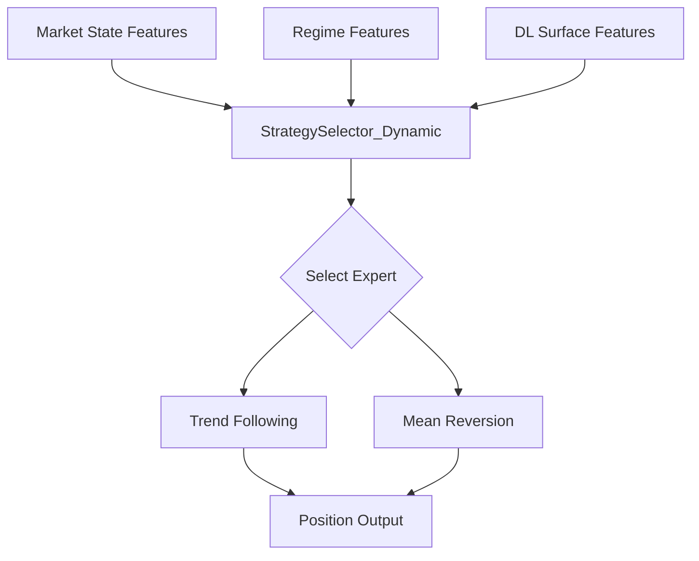

# Selector Architecture

# Overview

The MPML selector layer implements a:

> regime-aware mixture-of-experts routing system

for non-stationary time-series environments.

Rather than relying on a single monolithic strategy, the framework dynamically routes between specialized expert strategies using:

- engineered market-state features
- volatility structure
- regime information
- optional deep-learning prediction surfaces

The selector architecture evolved from:

- static rule-based routing
- toward ML-driven contextual decision making
- under strict walk-forward evaluation constraints.

---

# High-Level Architecture



---

```text
Feature Engineering
        ↓
Regime Labeling
        ↓
Specialized Experts
    ├── Trend Following (TF)
    └── Mean Reversion (MR)
            ↓
Selector Layer
    ├── PhaseAware
    └── StrategySelector_Dynamic
            ↓
Expert Selection
            ↓
Position Generation
            ↓
Walk-Forward Evaluation
```

---

# Design Philosophy

The selector architecture is based on the observation that:

> different market conditions favor different strategy behaviors.

Examples:

| Market State | Potentially Favored Expert |
|---|---|
| Strong directional trend | Trend Following |
| Range-bound / oscillatory | Mean Reversion |
| High-volatility transitions | Context-dependent |

Instead of attempting to build:

> one universally optimal strategy

MPML explores whether:

> contextual routing between specialists

can improve robustness.

---

# Expert Strategies

## Trend Following (TF)

The TF expert attempts to exploit:

- directional continuation
- momentum persistence
- trend stability

Typical characteristics:

- stronger during sustained directional movement
- vulnerable during rapid reversals
- often sensitive to volatility spikes

---

## Mean Reversion (MR)

The MR expert attempts to exploit:

- short-term overextension
- reversion toward local equilibrium
- oscillatory market behavior

Typical characteristics:

- more stable in sideways conditions
- vulnerable during sustained breakouts
- sensitive to directional persistence

---

# Selector Types

## Static Baselines

The framework includes static baselines for comparison:

- TF-only
- MR-only
- fixed routing logic

These provide reference points for evaluating:

- dynamic routing quality
- robustness improvements
- drawdown behavior

---

## PhaseAware Selector

The PhaseAware selector introduced:

- rule-based contextual routing
- engineered regime heuristics
- explicit volatility/state handling

Characteristics:

- interpretable behavior
- deterministic routing
- limited adaptability

PhaseAware became an important stepping stone toward:

> ML-driven contextual gating.

---

## StrategySelector_Dynamic

The dynamic selector is the primary ML routing architecture.

Core responsibilities:

- observe current market state
- evaluate contextual features
- estimate expert suitability
- route to the most appropriate expert

Primary implementation:

- XGBoost-based selector models

The selector is trained using:

- walk-forward-compatible training windows
- engineered contextual features
- historical expert behavior

### Routing and stability controls

At inference, `StrategySelector_Dynamic` predicts probabilities for the three
strategy types **TrendFollowing**, **MeanReversion**, and **PhaseAware** at each
bar. The predicted type is not applied directly: the routing layer first
requires sufficient confidence and, when enabled, a minimum probability margin
between the top two classes.

The selector uses **hysteresis** to reduce rapid switching. When currently in
`PhaseAware`, a specialist can be entered only when the top-class probability
reaches `tau_enter` (default `0.55`). Once in TF or MR, the selector remains
there while confidence stays above the lower `tau_exit` threshold (default
`0.50`); returning to `PhaseAware` therefore does not require the same
confidence needed to enter a specialist. TF↔MR switches require the higher
entry threshold and probability margin.

A minimum hold period (default 5 bars) can further suppress rapid specialist
switching. A maximum hold period (default 20 bars) can reset a specialist
selection to `PhaseAware` when the system is flat, preventing indefinite
specialist selection without interrupting an open trade. An optional
**volatility guard** can additionally override the normal gating decision during
extreme volatility.

If no pair-specific selector is available, or required prediction features are
temporarily unavailable, the system falls back to the configured PhaseAware
representatives. Schema mismatches are treated as hard errors rather than
silently falling back.

---

# Selector Reference Universe

## Separation of Concerns

MPML maintains three distinct strategy populations that must remain separate:

| Concept | Meaning |
|---|---|
| **Strategy Registry / Full Research Universe** | All registered strategies available for research and comparative evaluation (TF1–TF5, MR1–MR5, etc.) |
| **Selector Reference Universe** | The concrete representative strategies whose forward performance generates the labels used to train the selector |
| **Evaluation Scope** | The concrete strategies evaluated in a particular MPML experiment |

## Current Default Selector Reference Universe

For the default `phaseaware_default` policy the Selector Reference Universe is:

```
TF4
MR42
PhaseAware(TF4, MR42)
```

At inference, the selector's predicted strategy types map to these concrete representatives:

```
TrendFollowing → TF4
MeanReversion  → MR42
PhaseAware     → PhaseAware(TF4, MR42)
```

## Why the Separation Matters

Selector training labels are derived from forward performance of the reference strategies. If the full research universe were used instead, an unrelated strategy (e.g. MR32) could outperform MR42 over a training horizon, causing the selector to receive a `MeanReversion` label that represents MR32's behaviour — but at inference the selector will execute MR42.

This creates a **semantic mismatch** between selector training and selector inference.

## Reproducibility Invariant

> **Changes to strategies outside the Selector Reference Universe MUST NOT change selector training, selector routing, or the default benchmark, provided the configured selector reference strategies themselves are unchanged.**

In concrete terms: changing MR32, MR1, MR2, MR5, TF1, TF2, TF3, or TF5 must not alter the default selector benchmark.

## Policy-Derived Reference Universe

The Selector Reference Universe is derived from the configured PhaseAware evaluation policy via `resolve_phaseaware_strategy_pair()`. It is **not** a second hardcoded list.

The canonical source is `_build_selector_reference_results()`, which constructs the minimal full-history result set from the configured pair. This function is used by **both** selector-training paths:

- global selector training (step 4b/5)
- per-fold causal selector training (walk-forward)

A future research change may deliberately select different representatives by updating the configured policy. Such a change represents a new selector configuration and may intentionally produce a new benchmark.

## Implementation Note

`_build_selector_reference_results()` accepts optional `strategy_registry` and `policy_registry` parameters. When omitted, it uses the default registry and policy. The full `hardcoded_results` / research universe must **not** be passed to selector training paths.

---

# Feature Pipeline

The selector consumes multiple categories of features.

---

## Market Structure Features

Examples include:

- trend indicators
- ATR-derived volatility features
- momentum statistics
- rolling behavior metrics
- directional persistence measures

These features attempt to characterize:

> the current market environment.

---

## Regime Features

The regime layer provides:

- market-state classification
- directional context
- volatility-state context

The regime system evolved independently and is documented separately under:

`docs/regimes/`

---

## DL Surface Features (Optional)

MPML optionally integrates deep-learning prediction surfaces from:

> Market-Sentiment-ML (MSML)

Examples:

- sentiment-derived directional statistics
- prediction aggregates
- prediction volatility
- prediction flip frequency

These are attached as:

> contextual routing features

rather than direct trading signals.

The selector therefore evaluates:

- traditional engineered state features
- plus optional DL-derived contextual information.

---

# DL Integration Architecture

## Artifact Boundary

MSML exports parquet artifacts containing prediction surfaces.

MPML treats these artifacts as:

> immutable external feature surfaces.

This creates a clean separation between:

| Project | Responsibility |
|---|---|
| MSML | DL model training + surface generation |
| MPML | Routing + evaluation |

---

## Runtime Surface Propagation

At runtime:

- parquet metadata is introspected
- feature provenance is propagated
- experiment surfaces are emitted into manifests
- analysis layers consume canonical provenance metadata

This architecture evolved after earlier failures involving:

- semantic reconstruction
- feature-order corruption
- runtime attribution drift

---

# Imputation Awareness

A major architectural theme became:

> handling partial or missing DL coverage.

DL surfaces are only available for limited historical windows.

This created situations where:

- some folds had DL coverage
- others did not
- some features required imputation

The framework therefore introduced:

| Mode | Description |
|---|---|
| Blind | Selector does not observe imputation state |
| Aware | Missing/imputed state propagated explicitly |

The selector can therefore reason about:

> feature reliability

rather than treating all inputs equally.

---

# Feature Schema Hardening

One of the most important engineering evolutions in the project involved:

> selector schema integrity.

Early DL integration experiments uncovered:

- silent feature-order drift
- schema mismatch corruption
- hidden sklearn alignment failures
- fallback behavior masking runtime corruption

The selector infrastructure was hardened using:

- deterministic feature ordering
- canonical feature schemas
- hard-fail validation
- runtime schema assertions
- manifest provenance propagation
- regression tests

The system now treats:

> schema mismatch

as a hard runtime error.

## Audited implementation contracts

Current implementation-level contracts (audited in code/tests):

- `src/models.py: StrategySelector.train()`
  - freezes an exact fit-time `feature_schema_` for inference parity.
- `src/models.py: StrategySelector._prepare_inference_matrix()`
  - rebuilds deterministic inference matrices, regenerates optional `*_missing`
    indicators, validates exact schema equality, and reindexes to fit-time
    order before scaling.
- `src/models.py: validate_feature_schema()`
  - raises hard-fail `RuntimeError` on missing/extra/order-mismatch columns.
- `src/strategies.py: StrategySelector_Dynamic.generate_signals()`
  - catches only legitimate `ValueError` fallback cases and intentionally does
    not swallow schema-drift `RuntimeError`.

This reflects a deliberate anti-corruption design choice:

> selector schema drift is an integrity incident, not a warning.

---

## Constant missing-indicator handling and A/C regression (October 2026)

A targeted A-blind versus C-aware investigation found that the C-aware selector
could produce different probabilities from A at a bar where every optional DL
feature was unavailable. The investigation focused on EURAUD at
`2012-02-27T00:00:00`, using the `PERSISTENT_HH` surface and the TF4/MR42
selector configuration.

### Root cause

In the relevant C-aware training fold, five generated `*_missing` indicators
were constant at `1` because their corresponding optional DL features were
unavailable throughout the training matrix. Constant columns cannot provide a
split, but their presence changes the feature pool used by XGBoost's
`colsample_bytree` sampling. A controlled ablation reproduced the original
A and C probability vectors exactly, isolating the feature-set change as the
cause of the target-event discrepancy.

This is a fold-specific model-construction effect, not evidence that DL was
available at the target bar or that missingness awareness improves performance.

### Selector contract

`StrategySelector.train()` now records and removes only generated missing
indicators whose values are constant in that fit's training matrix:

- Constant `*_missing` indicators are excluded from the scaler and classifier.
- Indicators that vary in the training matrix are retained.
- The underlying optional DL feature columns are not removed by this rule.
- A/blind fits are unchanged when they do not contain generated missing
  indicators.
- At inference, the selector removes the same fit-time constant indicators
  before strict feature-schema validation. This keeps the inference matrix
  aligned with the fitted schema without weakening the schema check.

The fitted feature schema remains the source of truth for feature order. The
feature-importance report also uses `feature_schema_`, ensuring positional
importance values are labelled with the exact fit-time column order rather
than an independently sorted feature list.

### Targeted validation

The schema regression tests passed with **24 passed, 9 skipped**. The targeted
A/C rerun then passed its explicit probability-equality assertion for the
second matching trace record at the target timestamp:

| Strategy | Original A probability | Patched C probability | Difference |
|---|---:|---:|---:|
| MeanReversion | 0.6774810553 | 0.6774810553 | 0 |
| PhaseAware | 0.1791861802 | 0.1791861802 | 0 |
| TrendFollowing | 0.1433327943 | 0.1433327943 | 0 |

Both target records reported `dl_available=False`; the maximum absolute
probability difference was `0`, against a tolerance of `1e-6`. The first
matching trace record still had different probabilities, so the assertion
specifically compares the final matching record corresponding to the original
discrepancy.

The run was produced from Git commit
`90d8ea733b4a7fad1ebca8df95f6554bb3ae6e3d` with a dirty worktree. Its outputs
are under:

`results_archive/mpml_selector_trace_assert__A-blind_vs_C-aware__PERSISTENT_HH__20261022T161945Z/`

This validates the targeted regression only. It does not establish that A and
C are equivalent at other timestamps or folds, or that either variant has
better trading performance.

### Targeted diagnostic instrumentation

The investigation also added opt-in trace output in
`StrategySelector_Dynamic.generate_signals()`. When
`MPML_SELECTOR_TRACE_PATH`, `MPML_SELECTOR_TRACE_PAIR`, and
`MPML_SELECTOR_TRACE_TIMESTAMP` are set, the requested bar is written to JSONL
with raw features, DL availability, fitted feature schema, scaled inputs,
probabilities, gating state, and final selected strategy. The trace is disabled
when the path variable is unset.

The current working diff also contains a one-shot ablation-matrix export and
EURAUD/fold-0-specific feature/scaler logging in `src/models.py`. These are
investigation aids rather than selector architecture contracts; remove them or
explicitly retain and test them as supported diagnostics before treating the
change set as production-ready.

---

# Selector Lifecycle

## Training Phase

During training:

1. historical folds are constructed
2. features are assembled
3. optional DL surfaces are attached
4. imputation indicators are generated
5. canonical feature ordering is frozen
6. selector models are trained

The selector learns:

> contextual expert suitability.

---

## Inference Phase

During inference:

1. current market state is assembled
2. DL surfaces are attached if available
3. imputation handling is applied
4. feature schema validation occurs
5. canonical feature alignment is enforced
6. selector predicts expert suitability
7. expert routing decision is produced
8. the selected strategy type is mapped to its configured concrete
   representative (TF, MR, or PhaseAware)

The inference pipeline is intentionally:

- deterministic
- schema-validated
- provenance-aware

---

# Failure Modes

A major focus of the project became:

> explicit identification of selector failure modes.

Observed issues included:

- volatility-spike instability
- transfer failures across pair families
- routing collapse during abrupt transitions
- sparse DL coverage degradation
- hidden fallback masking
- feature-schema corruption

These findings motivated:

- volatility guards
- overlap-aware evaluation
- provenance-aware manifests
- anti-corruption validation
- deterministic replay infrastructure

---

# Evaluation Philosophy

The selector architecture prioritizes:

- robustness
- stability
- realistic evaluation
- causal integrity
- reproducibility

rather than:

- aggressive in-sample optimization
- fragile peak metrics
- static benchmark overfitting

The project increasingly evolved toward:

> contextual ML systems engineering

rather than merely:

> strategy optimization.

---

# Current Research Directions

Current selector-related research includes:

- transfer-learning behavior across pair families
- selector calibration
- HVTF vs LVTF surface transfer
- online adaptation
- alternate gating architectures
- confidence-aware routing
- feature attribution analysis
- robustness under distribution shift

---

# Related Documentation

| Topic | Location |
|---|---|
| Walk-forward evaluation pipeline | `docs/architecture/walkforward_pipeline.md` |
| DL integration contract | `docs/integration/dl_surface_integration.md` |
| Analysis/provenance framework | `docs/research/analysis_framework_v2.md` |
| Selector implementation audit | `docs/research/mpml_selector_audit.md` |
| Regime taxonomy | `docs/regimes/` |
| Experimental findings | `RESULTS.md` |
| Phase G3.1 Selector Reference Universe specification | `docs/architecture/MPML_Architecture_Roadmap.md` — Phase G3.1 |
| MR32 influence forensic audit | `docs/architecture/MPML_Forensic_Audit_MR32_Influence_on_Default_Selector_WalkForward_Benchmark.md` |
